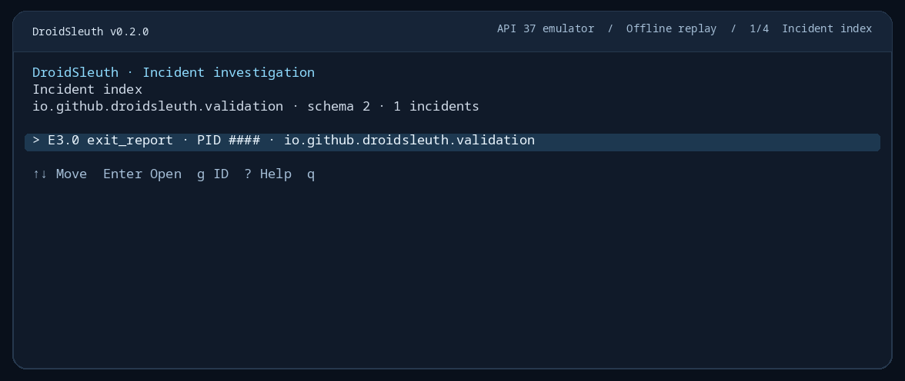

# DroidSleuth

**Investigate Android app exits, crashes, and hangs from your Linux terminal.**

An app disappears before you attach a debugger. By the time you check logcat,
the relevant lines may have rolled out of the buffer. DroidSleuth can retrieve
the exit history Android still retains or record a reproduction as it happens.
It saves the evidence in a local SQLite file you can inspect offline.



*Real DroidSleuth v0.2.0 output from a sanitized API 37 emulator validation
recording. The app was a disposable test fixture.* [Demo provenance](assets/README.md)

## Choose a workflow

Install v0.2.0 below, then run `droidsleuth devices` to check that your Android
device appears with state `device`. Replace `com.example.app` with your package
name and use a fresh output filename.

### The incident already happened

If the app is still installed, retrieve the exit reports Android retained for
the selected user.

```sh
droidsleuth collect-history --out incident.db com.example.app
droidsleuth investigate --tui incident.db
```

The recording contains reported exit reasons and available timestamps. An
empty result means the read returned no matching retained reports. See
[the usage guide](docs/usage.md#post-exit-collection) for source failures and
partial results.

### You can reproduce the incident

```sh
droidsleuth watch --summary --out repro.db com.example.app
```

Wait for **Capture ready**, reproduce the problem, then press **Ctrl+C** to
finalize. The summary prints the recorded incident IDs and commands for the
exact file. Add `--resources` before the package name to include CPU and RSS,
or `--duration 30s` for a timed recording.

```sh
droidsleuth investigate --tui repro.db
```

## What you can inspect

- **Process lifecycle.** DroidSleuth distinguishes process instances using
  boot ID, UID, PID, and kernel start ticks, so PID reuse cannot stand in for
  identity. Snapshot and diagnostic coverage gaps are tracked separately.
- **Diagnostic evidence.** Inspect scoped crash and ANR reports, Android exit
  history, and the exact stored lines supporting a finding.
- **Resource context.** Optional CPU and approximate RSS samples describe the
  validated main process across observed intervals.
- **Offline timelines.** A bounded ADB capture writes a local recording that
  the TUI, text and JSON views, and raw replay can read without a connected
  device. Replay and investigation read SQLite schemas 1–3.

## Platforms and requirements

- **Host:** Linux. The release binary targets Linux amd64. Source builds
  require Go 1.23 or newer.
- **Android collection:** Android 11 / API 30 or later, Android SDK
  Platform-Tools (`adb` on PATH), and an authorized ADB connection. Live
  process tracking requires readable process identity sources. No root or
  companion app is required.
- **Validation:** The v0.2.0 release gate exercised post-exit collection on
  API 30 AOSP and API 37 Google Play x86-64 emulators. Subsequent testing on a
  Motorola Edge 70 Fusion (API 37) verified exit history, live sampling with
  CPU/RSS, and offline investigation. One logcat poll reported incomplete
  coverage. [Validation scope](docs/usage.md#validation-scope)

## Install v0.2.0

Download the [Linux amd64 archive][archive] and [SHA256SUMS][checksums] from
the [published release][release] into the same directory.

```sh
sha256sum -c SHA256SUMS
tar -xzf droidsleuth-v0.2.0-linux-amd64.tar.gz
install -Dm755 droidsleuth-v0.2.0-linux-amd64/droidsleuth "$HOME/.local/bin/droidsleuth"
export PATH="$HOME/.local/bin:$PATH"
```

## Investigate from the terminal

```sh
droidsleuth investigate --timeline repro.db
droidsleuth investigate --timeline --json repro.db
droidsleuth replay --json repro.db
```

In the TUI, use **↑/↓** or **j/k** to move, **Enter** to open, **e** to show
evidence references, and **Esc** to go back. Use **g** to open an incident by ID,
**w** to change the context window, **?** for help, and **q** to quit.
The terminal needs at least 40 columns by 10 rows. See the
[usage guide](docs/usage.md#offline-investigation) for device selection,
incident IDs, and troubleshooting.

## Evidence and limits

- A process disappearance leaves its cause **unknown**. Android reports can
  have an **unproven association** with a particular process instance. CPU,
  RSS, and nearby events provide context.
- Diagnostic coverage can be **incomplete**. Logcat buffers roll over, record
  reads are bounded, OEM formats vary, and exit history may expire or arrive
  late. An empty read cannot rule out an incident.
- The lifecycle tracker covers the main process. Secondary, custom-named, and
  isolated processes fall outside that tracker.
- Recordings and exports may contain device serials and app diagnostics.
  Review and sanitize them before sharing.

## Documentation and contributions

- [Usage guide](docs/usage.md) for capture options, offline analysis, and troubleshooting
- [Contributing guide](CONTRIBUTING.md) for building, testing, and submitting changes
- [Implementation record](IMPLEMENTATION.md) for architecture, validation, and limitations
- [Research and roadmap](PLAN.md) for project goals
- [Releases][release] and [issue tracker](https://github.com/KartikeyaKotkar/droidsleuth/issues)

DroidSleuth is [MIT licensed](LICENSE).

[release]: https://github.com/KartikeyaKotkar/droidsleuth/releases/tag/v0.2.0
[archive]: https://github.com/KartikeyaKotkar/droidsleuth/releases/download/v0.2.0/droidsleuth-v0.2.0-linux-amd64.tar.gz
[checksums]: https://github.com/KartikeyaKotkar/droidsleuth/releases/download/v0.2.0/SHA256SUMS
